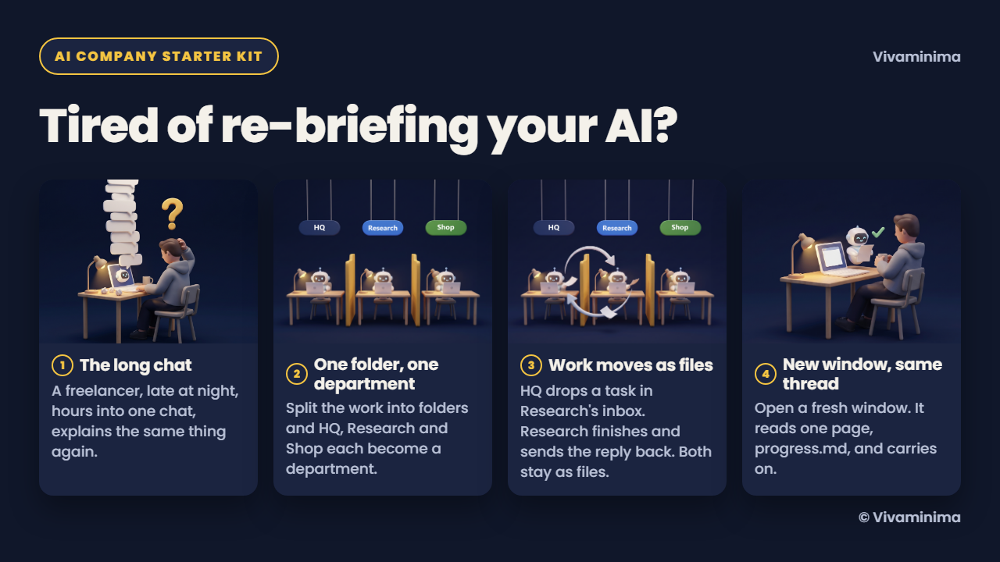

# AI Company Starter Kit

*Part of the [Vivaminima tools](https://github.com/vivaminima) for Claude Code users.*

<a href="https://vivastory4.gumroad.com/l/ai-company-starter-kit?utm_source=github&utm_medium=readme&utm_campaign=ai-company-starter-kit"></a>

**Full edition ($19, one-time payment on Gumroad):** https://vivastory4.gumroad.com/l/ai-company-starter-kit?utm_source=github&utm_medium=readme&utm_campaign=ai-company-starter-kit


A starter kit you use with the Claude desktop app. It is a sample company made of folders. Each folder is a department, each Claude window works as one department, and the departments hand work to each other through files.

## New to this? Start here

**Who it is for:** someone running a small business alone who has just started with the Claude desktop app and wants to split work across several windows.

**The problem it solves:** one long chat does everything and remembers nothing. Here every department has a written role, an inbox and a progress page, so a new window can pick up where the last one stopped by reading files.

**Four steps** (in the Claude desktop app, Code tab):

1. Unzip this folder somewhere on your computer.
2. In the Code tab, choose this folder as the project folder.
3. Type the sentence below.
4. Open `Research/_inbox/`. There is a new task file in it.

**Type this to Claude:**

    Read HQ/CLAUDE.md and act as the HQ lead. Send one task to Research through Research/_inbox.

**What you get back** (real output, run on 2026-11-12 by a fresh Claude Code agent session on an untouched copy of this folder; your wording will differ):

    I read HQ/CLAUDE.md and the company rules, then sent one task to Research.

    - The task asks Research to pick which of our three planners to feature in the
      December newsletter. It points Research at `Shop/products.md`. This was the item
      waiting under "Next" in the HQ progress file.
    - It is done when a file in `Research/output/` names exactly one planner and gives
      three reasons, each tied to a row or line of `Shop/products.md`. ...
    - Research will reply to `HQ/_inbox/`.
    - I added the task under "Waiting on" in `HQ/_status/progress.md` ...

    The task is not done yet. Research has not run, so there is no pick to report.

    Files changed:
    - Research/_inbox/2026-11-12_from-HQ_december-newsletter-pick.md (created)
    - HQ/_status/progress.md (modified)

The other two sentences, which finish the round, are in [START_HERE.md](START_HERE.md). The files that whole run produced are kept, unedited, in [examples/first-run/](examples/first-run/README.md).

## What is in the folder

| Path | What it is |
| --- | --- |
| `CLAUDE.md` | The company rules every department follows: how to send a task, how to do one, what not to touch. |
| `HQ/`, `Research/`, `Shop/` | Three departments. Each has a role (`CLAUDE.md`), an inbox (`_inbox/`) and a progress page (`_status/progress.md`). |
| `Shop/products.md` | Made-up product data, so the first task can be done without the internet. |
| `templates/task.md`, `templates/reply.md` | The two message formats. |
| `START_HERE.md` | Three sentences that take the company through one full round. |
| `examples/first-run/` | What a real run of those three sentences produced. |
| `tools/check_kit.py` | Optional checker. Reads the folder and reports problems. Changes nothing. |
| `skills/beginner-readme-section/` | A Claude Code skill that writes a "New to this? Start here" section for your own README. |
| `tests/` | 30 tests for the checker. |

Acme Studio, its products and every number in this folder are made up.

## How it works

```
 you (the owner)
   |  say what you want
   v
 HQ window ----- task file -----> Research/_inbox/      Research window
   ^                                                       |  does the task,
   |                                                       |  saves a result in Research/output/
   +----------- reply file <------ HQ/_inbox/ <------------+
   |
   v
 HQ/_status/progress.md   (the one page you read)
```

- A window becomes a department by reading that department's `CLAUDE.md`. The sentences in `START_HERE.md` begin with that instruction.
- A task is one Markdown file in the other department's `_inbox/`. It says what is needed, which files to read, and "Done when": something a person can check by opening a file.
- The department that did the work replies with a file in the sender's `_inbox/`, moves the task to `_inbox/done/`, and updates its own progress page.
- Departments write only in their own folder. The one exception is a new file in another department's inbox.

## What this kit does not do

- **Nothing runs by itself.** Each step happens when you type a sentence into a window. There are no hooks, no background jobs and no schedulers in this kit.
- **No keys, no accounts, no network.** The kit is Markdown files and one optional Python checker that only reads.
- **No script changes your Claude settings.** Nothing here writes to `settings.json` or anywhere outside this folder.
- **It does not make decisions for you.** The rules tell each department to put choices that are yours under "Needs the owner".

How well a department does its job depends on the model and on how clearly the task is written. Read the result files before you rely on them.

## Check the folder

With Python 3.8 or newer:

```
python tools/check_kit.py
python tools/check_kit.py --first-run
python tools/check_kit.py --banned my-words.txt
```

Real output of the first command on this folder as shipped:

```
AI Company Starter Kit, structure check 1.0.0

  OK    departments          3 found: HQ, Research, Shop
  OK    inbox and status     every department has _inbox/ and _status/progress.md
  OK    CLAUDE.md size       4 file(s); largest is CLAUDE.md, about 468 tokens (limit 4000)
  OK    links                6 relative link(s), 0 broken
  OK    starter sentences    5 block(s), 11 path(s), 0 missing
  --    banned words         no list given (use --banned FILE)

Result: PASS (5 check(s) passed, 0 failed)
```

| Check | Fails when |
| --- | --- |
| departments | No folder below the top has a `CLAUDE.md`. |
| inbox and status | A department has no `_inbox/` or no `_status/progress.md`. |
| CLAUDE.md size | A `CLAUDE.md` is estimated at more than 4,000 tokens (`--max-tokens` changes the limit). The estimate is 4 characters per token for English. |
| links | A relative Markdown link points at a file that is not there. |
| starter sentences | A path named in a sentence in `START_HERE.md` does not exist. |
| banned words | A word from your own list (`--banned FILE`, one word or phrase per line) appears in the folder. Useful before you share your company folder with anyone. |
| `--first-run` | Shows which of the three starter sentences have been run. |

Exit code 0 means pass, 1 means at least one check failed, 2 means the folder or list could not be read.

## Make it yours

1. Rewrite the first paragraph of `CLAUDE.md` to describe your business.
2. Replace `Shop/products.md` with your own data, or delete `Shop/` and make the department you need.
3. To add a department: copy a department folder, rename it, rewrite its `CLAUDE.md`, and add a row to the table in `HQ/CLAUDE.md`.
4. Run `python tools/check_kit.py`.

Keep each `CLAUDE.md` short. A role that fits on one screen gets followed; a long one gets skimmed.

## The included skill

`skills/beginner-readme-section/` is a Claude Code skill. To use it, copy that folder into your skills folder (`.claude/skills/` in a project, or the `.claude/skills/` folder in your home directory), start a new session in a repository, and say: `add a beginner section to my README`. It writes the section at the top of this README's kind, and it only puts real output in it.

## Tests

```
python -m unittest discover -s tests -v
```

30 tests: the structure checks, link checking, the starter-sentence check, the banned-word list, the first-run check, Korean folder names, a cp949 console, and that the checker writes nothing.

## Known limits

- The first-run output above comes from one run. A different model, or the same model on another day, will word the task differently and may make different choices.
- The run was made by starting a fresh agent with the sentence and this folder, not by clicking through the Claude desktop app window.
- The token count is an estimate, not the model's own count.
- Tested on Windows with Python 3.10.

## Not affiliated

This kit is used with the Claude desktop app. It is not affiliated with, endorsed by or sponsored by Anthropic.

## Licence

MIT. See [LICENSE](LICENSE). Copyright (c) 2026 Vivaminima.

## More from Vivaminima

- **AI Company Starter Kit (full edition) ($19)**, the paid edition of this tool, one-time payment on Gumroad: https://vivastory4.gumroad.com/l/ai-company-starter-kit

  <a href="https://vivastory4.gumroad.com/l/ai-company-starter-kit"></a>

- **Token Audit Kit ($19)** — see how many tokens your CLAUDE.md and its @imports cost before your first prompt, and a step-by-step guide to split it. Free script: https://github.com/vivaminima/context-file-audit · Paid kit (store): https://vivastory4.gumroad.com
- Free tools: [skill-audit-kit](https://github.com/vivaminima/skill-audit-kit) · [secret-map](https://github.com/vivaminima/secret-map) · [inbox-ledger](https://github.com/vivaminima/inbox-ledger) · [release-gate](https://github.com/vivaminima/release-gate) · [skill-install-gate](https://github.com/vivaminima/skill-install-gate) · [console-safe](https://github.com/vivaminima/console-safe) · [checklist-stop](https://github.com/vivaminima/checklist-stop) · [handoff-check](https://github.com/vivaminima/handoff-check) · [llm-budget-router-lite](https://github.com/vivaminima/llm-budget-router-lite) · [go-no-go-verdict-skill](https://github.com/vivaminima/go-no-go-verdict-skill) · [ai-company-starter-kit](https://github.com/vivaminima/ai-company-starter-kit) · [beginner-readme-section](https://github.com/vivaminima/beginner-readme-section)

Vivaminima is not affiliated with, endorsed by or sponsored by Anthropic.
